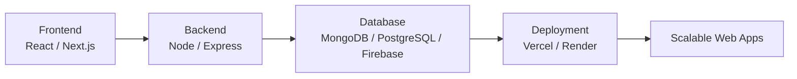

<h1 align="center">
  
</h1>

<h3 align="center">
🌐 Full Stack Web Developer | ⚛️ React & Next.js | ☁️ Salesforce Certified | 🚀 Modern UI/UX Builder
</h3>

<p align="center">
  
</p>

<p align="center">
  CS undergraduate (2027) · Open to entry-level Software Developer roles
</p>

---


# 💻 About Me

```yaml
Name: Rakesh K

Role:
  - Full Stack Web Developer
  - Salesforce Platform Developer

Education:
  - B.E. Computer Science & Engineering (2023 - 2027)
  - Alva's Institute of Engineering and Technology, Mangalore

Specialization:
  - Frontend Development (React, Next.js, Tailwind)
  - Backend Development (Node.js, Express, REST APIs)
  - Salesforce (Apex, LWC, Flows, SOQL)
  - AI-integrated web applications

Currently Working On:
  - Target-X: AI-powered CRISPR gRNA design platform

Currently Learning:
  - Docker & Kubernetes
  - CI/CD
  - Scalable Architecture
  - Cloud Computing

Passionate About:
  - Clean UI/UX
  - Secure, scalable systems
  - Applying AI to real products
```

✨ I build modern, scalable, high-performance web applications.

⚡ I love responsive interfaces, clean backend systems, and smooth user experiences.

🏆 Top 30 of 100+ teams at **Udgama National Hackathon 2025** · Finalist at **ICFAI GenAI Hackathon 2025**

🌱 Exploring:
- React.js & Next.js
- Node.js & Express
- Cloud Computing
- Full Stack Development
- UI/UX Design

---

# 🚀 Featured Projects

<div align="center">

<table>
<tr>
<td width="50%">

## 🏢 Faculty Appraisal Portal (FSAMS)

🔹 Role-based appraisal workflow: draft → submitted → HOD-approved → final-reviewed

🔹 JWT auth, RBAC, bcrypt, Helmet, rate limiting

🔹 Scoring engine, PDF export, email notifications, CSV onboarding

🛠️ React · Node.js · Express · MongoDB

🔗 [View Project](https://github.com/rakeshk325/REPO-NAME)

</td>

<td width="50%">

## 💉 VaxTrack: Vaccination Management

🔹 Dual UIP/IAP schedules with dynamic due-date calculation

🔹 Atomic Firestore batch writes for records, appointments, inventory

🔹 Gemini-powered appointment slot recommender

🛠️ Next.js 15 · TypeScript · Firebase · Genkit

🔗 [View Project](https://github.com/RakeshK325/Vaccination-management-System)

</td>
</tr>

<tr>
<td width="50%">

## 🧬 Target-X: CRISPR gRNA Design

🔹 8-stage pipeline from gene identification to ranked candidates

🔹 ML ensemble (XGBoost, LightGBM, Random Forest, CatBoost, PyTorch) with SHAP explainability

🔹 Interactive research dashboard

🛠️ React · TypeScript · tRPC · MySQL · Drizzle ORM

🔗 [View Project](https://github.com/rakeshk325/REPO-NAME)

</td>

<td width="50%">

## 📋 FlowBoard: Project & Task Manager

🔹 Responsive dashboard with a custom design system

🔹 REST API with centralized validation and authentication

🔹 LLM feature that turns project briefs into prioritized tasks

🛠️ Next.js · Tailwind · Express · PostgreSQL

🚀 Deployed on Vercel + Render

</td>
</tr>
</table>

</div>

### 🎯 Future Goals

🔹 Building AI-powered web applications
🔹 Creating impactful, scalable systems

---

# ⚡ Tech Stack

<p align="center">
  
</p>

---

# 🌐 Web Development Vision

<p align="center">
  
</p>

<div align="center">



</div>

---

# 📊 GitHub Analytics

<p align="center">
  
  
</p>

<p align="center">
  
</p>

---

# 🐍 Contribution Snake

<p align="center">
  
</p>

---

# 🌐 Connect With Me

<p align="center">
  <a href="https://linkedin.com/in/rakesh-k325" target="_blank">
    
  </a>
  <a href="https://rakesh-s-3d-portfolio.vercel.app" target="_blank">
    
  </a>
  <a href="https://kaggle.com/rakeshk32" target="_blank">
    
  </a>
  <a href="mailto:rakesh160982@gmail.com">
    
  </a>
  <a href="https://instagram.com/ohh.itzz__rakesh" target="_blank">
    
  </a>
</p>

---

# 💡 Developer Philosophy

<div align="center">

### 🚀 “Building fast, scalable, and user-friendly web experiences with modern technologies.”

</div>

---

# 📈 Profile Views

<p align="center">
  
</p>

---

# ⚡ Random Dev Quote

<p align="center">
  
</p>

---

<p align="center">
  
</p>
