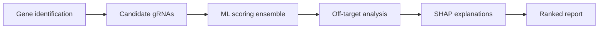

<!-- ═══════════════ HEADER ═══════════════ -->
<p align="center">
  
</p>

<p align="center">
  
</p>

<p align="center">
  
  
  
</p>

---

## `~/rakesh/whoami`

```ts
const rakesh: Developer = {
  role:       "Final-year CSE student → Software Developer",
  college:    "Alva's Institute of Engineering & Technology",
  certified:  ["Salesforce Platform Developer"],
  builds:     ["MERN apps", "Next.js + TypeScript products", "LLM-powered features"],
  strengths:  ["secure auth (JWT / RBAC)", "clean REST APIs", "responsive UI", "data modelling"],
  published:  "TargetX: AI-assisted CRISPR gRNA design (IICCCS-2026, 19–20 Nov)",
  learning:   ["Docker & Kubernetes", "CI/CD", "scalable architecture"],
  lookingFor: "a team where I can ship real features and learn fast",
};
```

---

## 🏆 Highlights

| | |
|---|---|
| 📄 **Research** | Paper *TargetX* accepted at **IICCCS-2026**, Asansol Engineering College |
| ☁️ **Certified** | **Salesforce Platform Developer**: Apex · LWC · Flows · SOQL · Triggers |
| 🥇 **Hackathons** | **Top 30 of 100+ teams** at Udgama National Hackathon 2025 · Finalist, **ICFAI GenAI Hackathon 2025** |
| 💼 **Internship** | Full Stack Development Intern at **Innovation Hacks**, shipped *FlowBoard* end to end |

---

## 🚀 Things I've Built

### 🧬 Target-X: AI-Powered CRISPR gRNA Design
An 8-stage pipeline that takes a gene from identification to ranked, explainable guide RNA candidates.

- ML ensemble: **XGBoost · LightGBM · Random Forest · CatBoost · PyTorch** predicting on-target efficiency and off-target risk
- **SHAP explainability** so every ranking can be justified
- React + TypeScript dashboard on a **tRPC** API, **MySQL** via Drizzle ORM

`React` `TypeScript` `tRPC` `MySQL` `Python` `PyTorch`



---

### 🏢 FSAMS: Faculty Self-Appraisal Management System
A MERN platform for **Faculty → HOD → Principal → Admin** with a status-driven workflow.

- **JWT + RBAC**, bcrypt, Helmet, rate limiting, CORS, department-level access
- Section-wise scoring, proof uploads (Multer), **PDF export** (Puppeteer), emails (Nodemailer), **CSV bulk onboarding**

`React` `Node.js` `Express` `MongoDB` `JWT`

🔗 [Source code](https://github.com/rakeshk325/REPO-NAME)

---

### 💉 VaxTrack India: Pediatric Vaccination Management
Parents and hospitals track vaccinations, book appointments and manage stock.

- Calculates **UIP (government) and IAP (private)** due dates from date of birth
- **Atomic Firestore batch writes** across vaccination, appointment and stock; Security Rules; QR-coded certificates
- **Genkit + Gemini 2.5 Flash** with Zod-validated output to suggest the best vaccination slot

`Next.js` `TypeScript` `Firebase` `Genkit` `Gemini`

🔗 [Source code](https://github.com/RakeshK325/Vaccination-management-System)

---

### 📋 FlowBoard: Task Manager with an AI Planner
Built during my internship: frontend, API, database and deployment.

- Responsive Next.js + Tailwind dashboard with reusable components and proper error states
- Express REST API on **PostgreSQL** with validation and authentication
- **LLM feature** that turns a project brief into prioritized tasks
- Deployed on **Vercel + Render**

`Next.js` `Tailwind` `Express` `PostgreSQL`

---

## 🧰 Toolbox

<p>
  <br/>
  
</p>

<details>
<summary><b>Full breakdown</b></summary>

| Area | Stack |
|---|---|
| Languages | Java, Python, C, JavaScript, TypeScript, SQL |
| Frontend | React, Next.js, Vite, Tailwind CSS |
| Backend | Node.js, Express.js, tRPC, REST APIs, JWT, RBAC |
| Databases | PostgreSQL, MySQL, MongoDB, Firestore, Mongoose, Drizzle ORM |
| AI / ML | LLM integration (Genkit, Gemini), scikit-learn, XGBoost, PyTorch |
| Salesforce | Apex, SOQL/SOSL, LWC, Flows, Triggers, Visualforce, Salesforce DX |
| DevOps | Git, GitHub, Docker, Vercel, Render · *familiar with* Kubernetes, CI/CD |
| Core CS | DSA, OOP, DBMS |

</details>

---

## 📊 GitHub Stats

<p align="center">
  
  
</p>

<p align="center">
  
</p>

---

## 🤝 Let's Talk

I'm looking for an entry-level **Software Developer** role. If you're hiring, building something interesting, or want to talk about CRISPR + ML, I'd love to hear from you.

<p>
  <a href="https://linkedin.com/in/rakesh-k325"></a>
  <a href="https://rakesh-s-3d-portfolio.vercel.app"></a>
  <a href="mailto:rakesh160982@gmail.com"></a>
  <a href="https://kaggle.com/rakeshk32"></a>
</p>

<p align="center">
  
</p>
